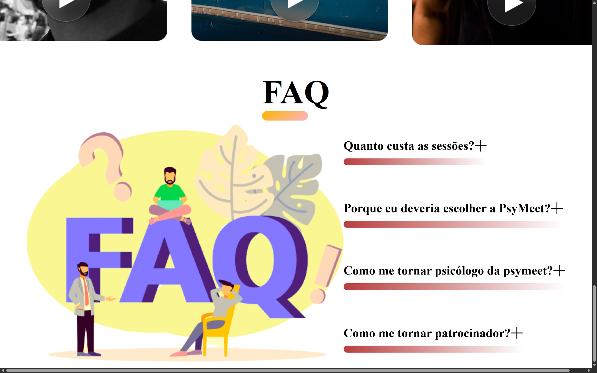
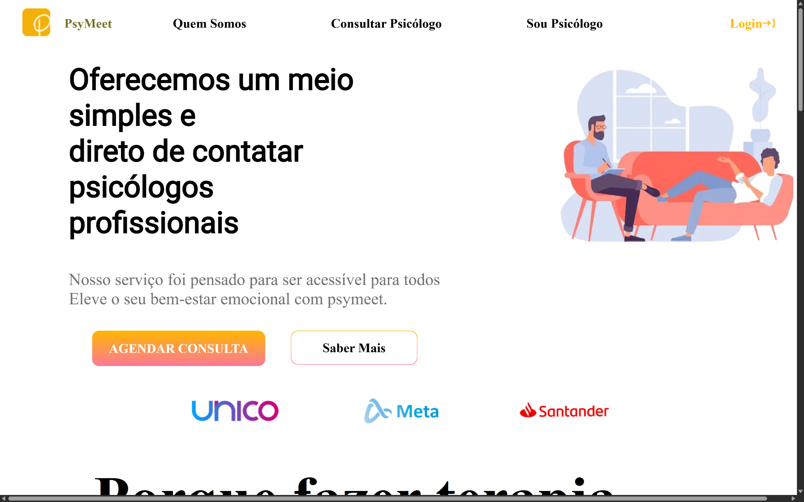
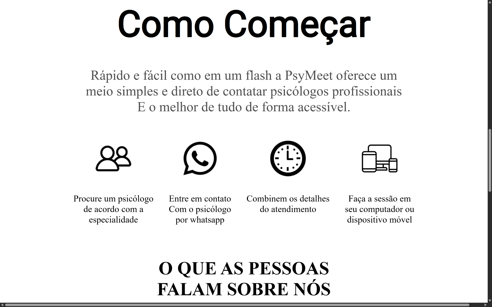
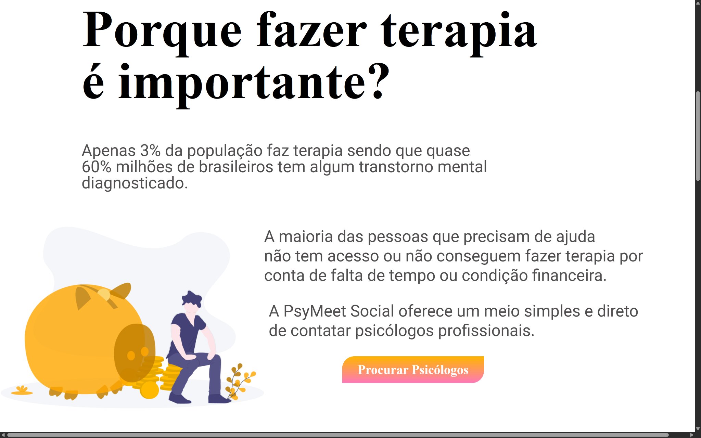

# PsyMeet

Учебный проект по HTML и CSS. Создан для практики вёрстки веб-страниц по макету из Figma.

**PsyMeet** — макет сайта сервиса психологических консультаций.

## Технологии

- HTML5
- CSS3
- Figma

## Что сделано

- Главная страница и навигация
- Информационные разделы
- Блок «Как начать»
- Карточки отзывов
- Раздел FAQ

## Скриншоты

### Главная страница

### Информационный раздел

### Как начать

### Отзывы

### FAQ

## О проекте

Проект создан для изучения HTML, CSS и практики переноса дизайна из Figma в браузер. Backend отсутствует.
